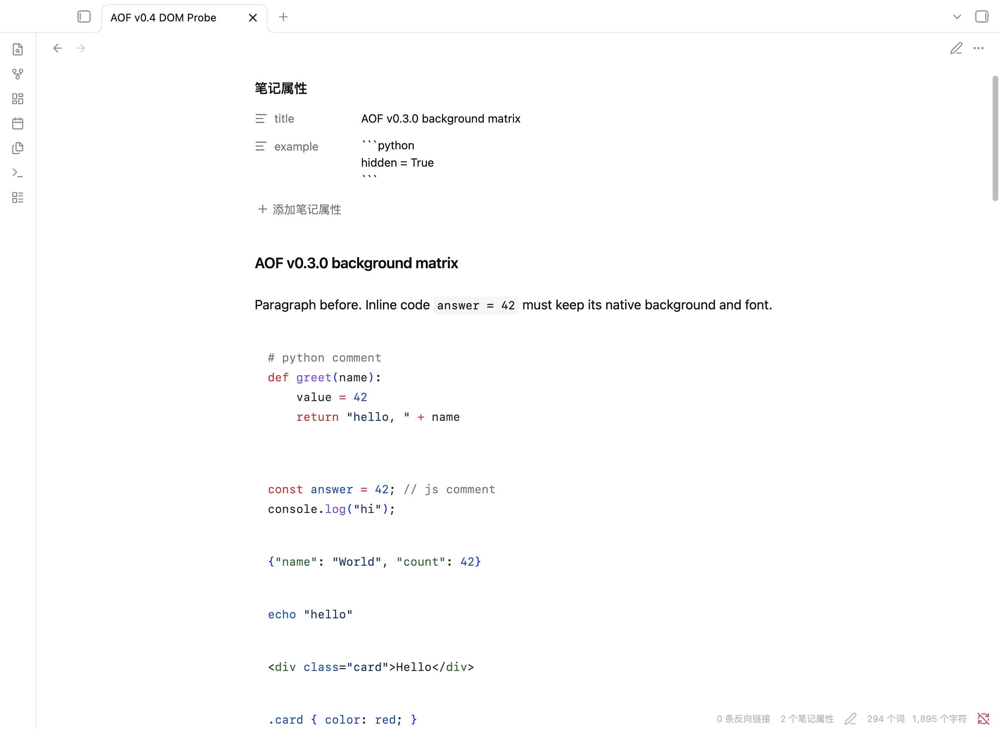
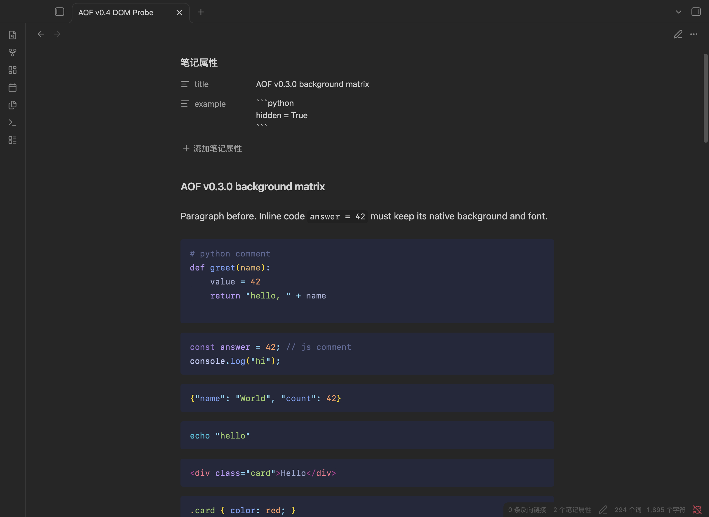
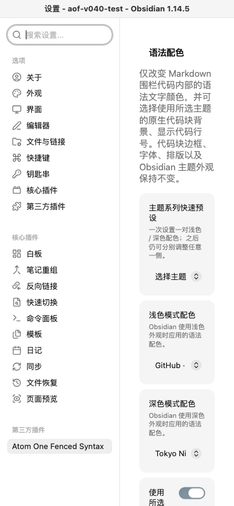

[English](README.md) · [简体中文](README.zh-CN.md)

# Syntax Palette

*Every code block deserves its own color.*

Code is more than something to read. Its colors shape how we see, understand, and work with it.

Syntax Palette brings a carefully curated collection of syntax color palettes to Obsidian, giving your code blocks a visual identity of their own — while leaving the rest of your workspace untouched.

Choose a palette that feels right. Let your notes remain yours.

## A Palette for Every Perspective

Explore 40 color variations across 16 carefully selected theme families, from timeless classics to modern editor favorites.

Inspired by GitHub, Atom One, Catppuccin, Tokyo Night, Ayu, VS Code, JetBrains, Dracula, Nord, and more.

Whether you prefer a bright, understated workspace or a darker, more immersive atmosphere, there is a palette to match your way of working.

## Designed Around Your Workflow

- **Light & Dark Palettes** — Choose independent color palettes for light and dark modes, or let them follow the same theme family.
- **A Personal Touch** — Give code blocks their own background colors, with the option to turn them off.
- **Line Numbers** — Add line numbers when you need them. They remain visual guides and never become part of your notes.
- **Flexible Wrapping** — Choose whether long lines wrap within the editor or scroll horizontally.
- **Native by Design** — Your regular text, inline code, and the rest of Obsidian remain untouched.

Changes take effect immediately and are saved for your next session.

## See It in Obsidian

  
  

<em>Light and dark appearances with different code palettes.</em>

  

<em>The settings page lets you choose palettes and optional code-block features.</em>

These are genuine screenshots from an isolated Obsidian test vault, captured with the v0.5.2 development build before the plugin was renamed from **Atom One Fenced Syntax**. The settings screenshot still shows that earlier name; the code colors and controls shown are real.

## Availability & Installation

Install Syntax Palette directly through Obsidian Community Plugins.

For manual installation, download the latest release from [GitHub Releases](https://github.com/bilibilijojo/obsidian-syntax-palette/releases) and place `manifest.json`, `main.js`, and `styles.css` in:

`.obsidian/plugins/syntax-palette/`

Then reload Obsidian and enable Syntax Palette under Community Plugins.

## A Note on Design

Syntax Palette was built around a simple idea:

**Your notes should stay yours.**

No changes to your workspace, no imposed visual style. Just a little more freedom in how your code looks.

## License

Syntax Palette's project code is released under the [Apache License 2.0](LICENSE). Bundled third-party components retain their original licenses; see [THIRD-PARTY-NOTICES.txt](THIRD-PARTY-NOTICES.txt) for details.
