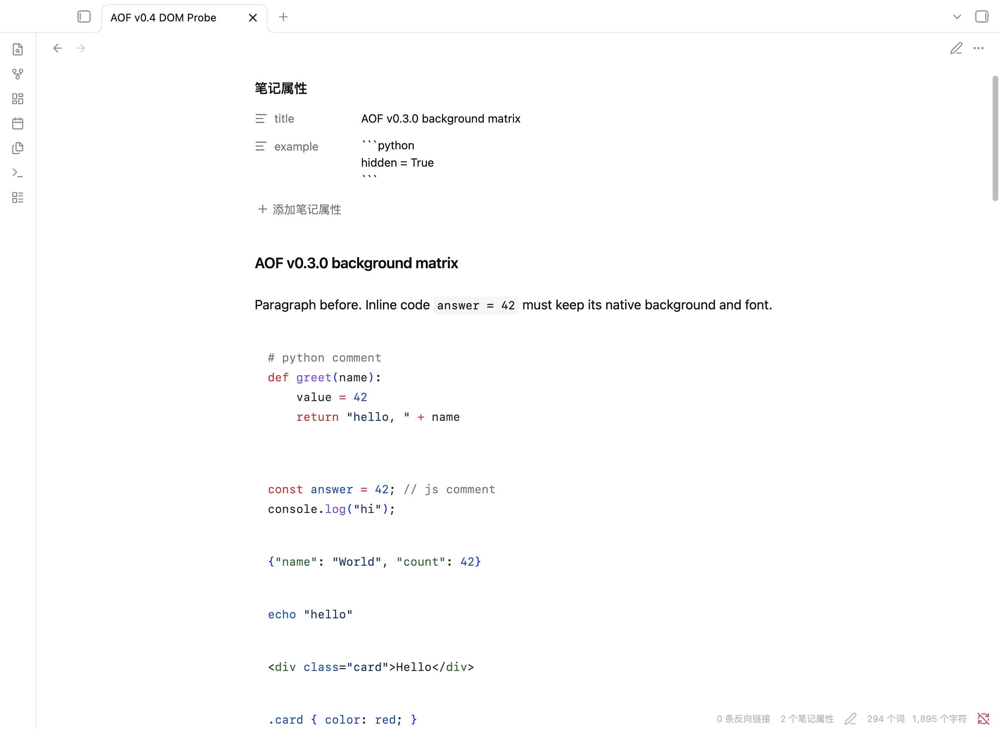
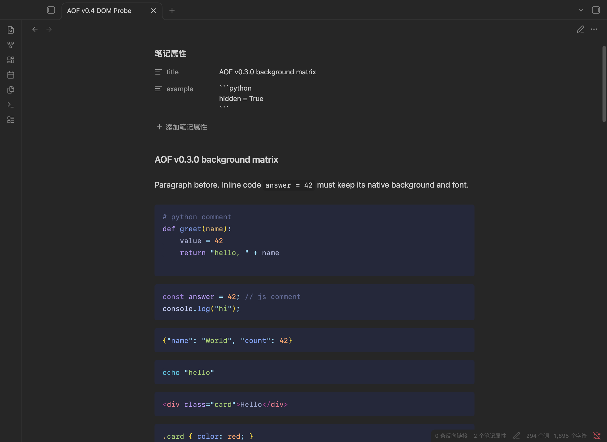
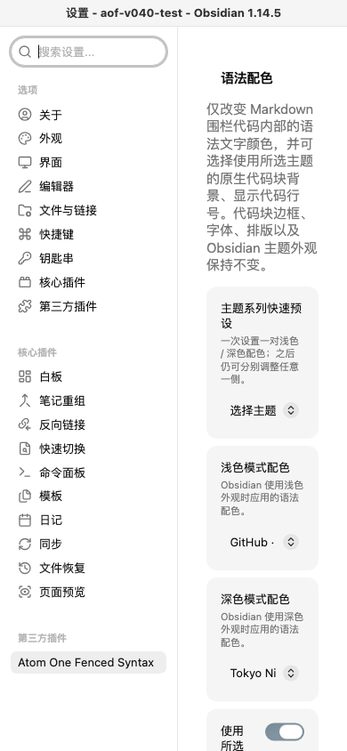

[English](README.md) · [简体中文](README.zh-CN.md)

# Syntax Palette

*每个代码块，都值得拥有自己的色彩。*

代码不只是用来阅读的文字。色彩也会影响我们观察、理解和处理代码的方式。

Syntax Palette 为 Obsidian 带来精心挑选的语法配色，让代码块拥有自己的视觉风格，同时保留工作区其他部分原有的外观。

选择让你赏心悦目的配色，让笔记保持你喜欢的样子。

## 总有一款配色适合你

从历久弥新的经典到现代编辑器中的热门选择，探索 16 个精选主题系列中的 40 种配色。

灵感来自 GitHub、Atom One、Catppuccin、Tokyo Night、Ayu、VS Code、JetBrains、Dracula、Nord 等主题。

无论你喜欢明亮、简约的工作环境，还是偏爱深色、沉浸的氛围，都能找到适合自己工作方式的配色。

## 为你的工作方式而设计

- **浅色与深色配色** —— 为浅色和深色模式分别选择配色，或让它们使用同一主题系列。
- **个性化背景** —— 为代码块设置独立背景色，也可以随时关闭。
- **行号** —— 需要时显示行号。它们只是视觉辅助，不会成为笔记内容的一部分。
- **灵活换行** —— 选择让编辑器中的长代码行自动换行，或通过横向滚动查看。
- **融入原有外观** —— 普通正文、行内代码和 Obsidian 的其他部分保持原样。

设置立即生效，并会保存供下次使用。

## 在 Obsidian 中查看效果

  
  

<em>浅色与深色外观下使用不同代码配色。</em>

  

<em>在设置中选择配色，并按需开启代码块功能。</em>

这些截图来自隔离的 Obsidian 测试库，使用的是更名之前的 v0.5.2 开发版本，当时插件名为 **Atom One Fenced Syntax**。设置页截图仍显示旧名称；图中的代码配色和设置控件都是真实效果。

## 获取与安装

你可以直接通过 Obsidian 社区插件商店安装 Syntax Palette。

如需手动安装，请从 [GitHub Releases](https://github.com/bilibilijojo/obsidian-syntax-palette/releases) 下载最新版本，并将 `manifest.json`、`main.js` 和 `styles.css` 放入：

`.obsidian/plugins/syntax-palette/`

然后重新加载 Obsidian，在第三方插件设置中启用 Syntax Palette。

## 关于设计

Syntax Palette 的设计始于一个简单的想法：

**你的笔记，应该由你做主。**

不改变你的工作区，也不强加视觉风格，只为代码的外观多提供一点自由。

## 许可证

Syntax Palette 的项目代码采用 [Apache License 2.0](LICENSE)。内置的第三方组件继续遵循各自的原始许可证，详情请参阅 [THIRD-PARTY-NOTICES.txt](THIRD-PARTY-NOTICES.txt)。
