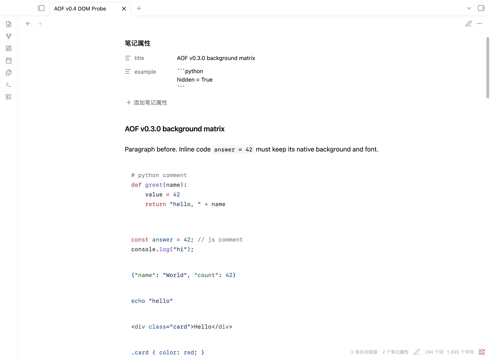
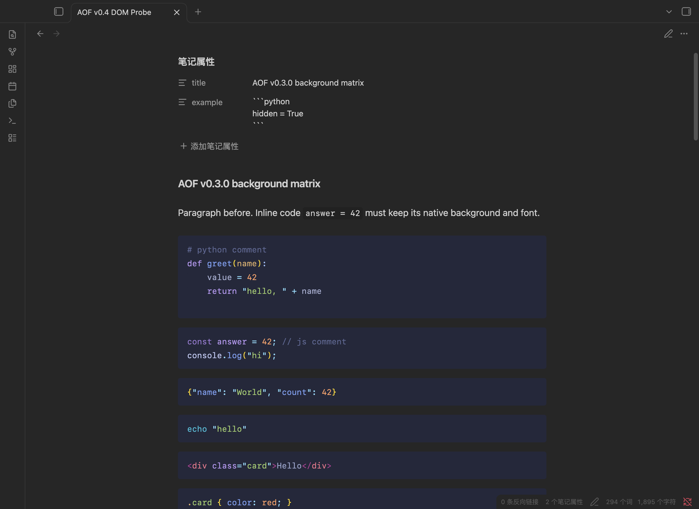
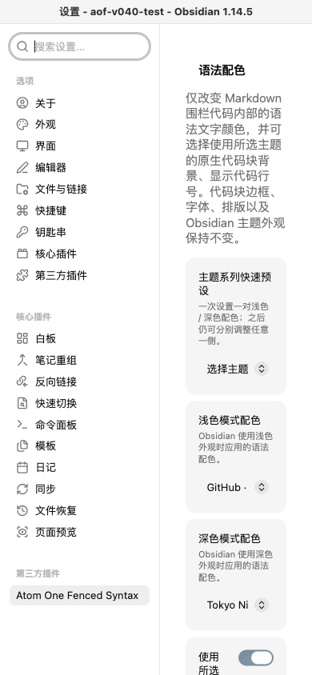

[English](README.md) · [简体中文](README.zh-CN.md)

# Syntax Palette

**让代码块用你喜欢的颜色显示。**

为 Obsidian Markdown 围栏代码选择语法配色，不必更换整个 Obsidian 主题。笔记正文、应用界面和其他部分仍保持原来的外观。

## 在 Obsidian 中查看效果

<p align="center">
  
  
</p>
<p align="center"><em>浅色与深色外观下使用不同代码配色。</em></p>

<p align="center">
  
</p>
<p align="center"><em>在设置中选择配色，并按需开启代码块功能。</em></p>

这些截图来自隔离的 Obsidian 测试库，使用的是更名之前的 v0.5.2 开发版本，当时插件名为 **Atom One Fenced Syntax**。设置页截图仍显示旧名称；图中的代码配色和设置控件都是真实效果。

## 它会改变什么？又会保留什么？

Obsidian 主题负责整个应用的外观。Syntax Palette 让 Markdown 围栏代码块可以使用单独的配色，这样你可以保留喜欢的 Obsidian 主题，同时为代码选择合适的颜色。

配色只作用于围栏代码块，不会给普通正文或行内代码重新上色，也不会修改 Markdown 原文。你还可以选择是否为围栏代码块更换背景颜色。

## 选择喜欢的配色

插件内置 **15 个主题系列、39 种配色**，包括 GitHub、Atom One、Catppuccin、Tokyo Night、Ayu、Dracula、Nord 等。浅色和深色外观可以分别选择配色，并随 Obsidian 外观切换。

你还可以：

- 按需开启代码块背景。默认关闭。
- 显示代码行号。每个代码块都从 1 开始；行号默认关闭，也不会被复制进笔记。
- 选择编辑视图中的长代码行是否换行（默认关闭）。关闭换行时，每个代码块独立横向滚动，笔记其他内容不会跟着移动。
- 保持普通文字的 Obsidian 原生换行。编辑视图的换行选项只影响围栏代码。

常见语言均有语法配色，包括 Python、JavaScript 和 TypeScript、JSON、Bash、HTML、CSS。插件不识别的语言或未标记语言的代码块继续使用 Obsidian 原有语法配色。

## 如何使用

安装 Syntax Palette 后：

1. 打开 **设置 → 第三方插件 → Syntax Palette**。
2. 分别为**浅色模式**和**深色模式**选择配色。你可以先选一个系列预设，再单独调整任意一侧。
3. 按需开启代码块背景或行号。
4. 根据阅读习惯设置编辑视图中的代码自动换行。

设置会立即生效，并保存供下次打开 Obsidian 时使用。

## 当前安装状态

Syntax Palette 正在准备首次公开发布，**尚未上架 Obsidian 社区插件商店**，目前也尚未发布公开 Release。

Release 发布后，可以从 [GitHub Release](https://github.com/bilibilijojo/obsidian-syntax-palette/releases) 下载 `main.js`、`manifest.json`、`styles.css`，将这三个文件放入 Vault 的 `.obsidian/plugins/syntax-palette/` 文件夹，重新加载 Obsidian，然后在 **设置 → 第三方插件** 中启用 Syntax Palette。这三个文件包含完整运行所需资源，无需另外补充 WASM 文件。

本地从源码构建时，使用 `plugin/syntax-palette/` 中的同名三个文件即可。详见[安装说明](docs/INSTALLATION.md)。

## 兼容性与已知限制

- 仅支持 Obsidian 桌面版；不支持 iOS、iPadOS 和 Android。
- 已在 macOS / Obsidian 1.14.5 上测试。Windows 和 Linux 是目标平台，但尚未在这些系统上实机测试。
- 暂不支持 Obsidian 弹出窗口（pop-out）。
- 目前仅提供内置的 39 种配色，不能导入自定义主题文件。
- 编辑视图关闭自动换行时，长代码行需要在各自的代码块内横向滚动查看。

## 开发者信息

插件源码位于 `plugin-src/`；内置主题数据、来源记录和第三方许可证位于 `sources/`。构建时会把 Oniguruma WASM 内嵌到 `main.js`，社区插件安装文件中不需要另带运行时资源。完整第三方许可通知会随 `main.js` 和 `THIRD-PARTY-NOTICES.txt` 一同分发。主题署名和许可证见[主题来源说明](docs/THEME-PROVENANCE.md)，开发与测试记录见 [开发指南](docs/DEVELOPMENT.md)。

从源码构建：

```sh
npm ci
npm run verify
npm run build
npm run package
npm run verify-build
```

## 许可证

公开作者：[Frank](https://github.com/bilibilijojo)。此名称用于项目署名，不代表已确认历史代码或第三方资源的版权归属。

Syntax Palette 自有项目代码采用 [Apache License 2.0](LICENSE)。内置主题、语法定义、源自第三方的解析代码和运行时组件继续遵循各自的原始许可证；相关声明和完整许可证文本见 [THIRD-PARTY-NOTICES.txt](THIRD-PARTY-NOTICES.txt)。主题快照及其准确版本记录在[主题来源说明](docs/THEME-PROVENANCE.md)中。

贡献前请先通过 Issue 讨论拟议的修改。当前需要项目所有者复核的事项见 [LICENSE-AUDIT.md](docs/release/LICENSE-AUDIT.md) 和 [RELEASE-AUDIT.md](docs/release/RELEASE-AUDIT.md)。
